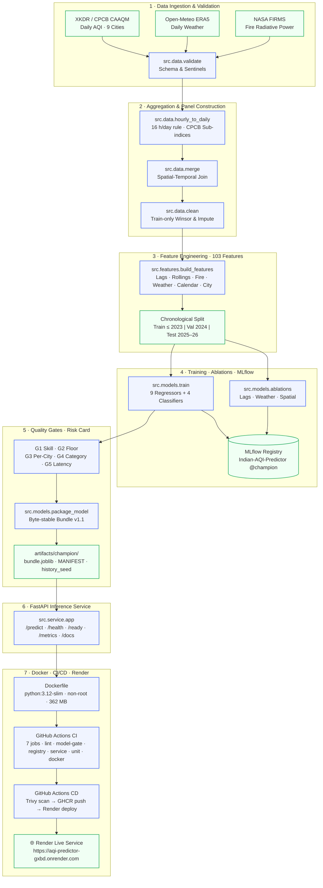

# AI-Based Air Quality Awareness Assistant — MLOps Milestone 2

[](https://www.python.org/downloads/)
[](https://dvc.org/)
[](https://mlflow.org/)
[](https://opensource.org/licenses/MIT)
[](https://github.com/psf/black)
[](https://github.com/SuhasRaghavendra/aqi-awareness-assistant/actions/workflows/ci.yml)
[](https://github.com/SuhasRaghavendra/aqi-awareness-assistant/actions/workflows/cd.yml)
[](https://aqi-predictor-gxbd.onrender.com/docs)
[](https://github.com/SuhasRaghavendra/aqi-awareness-assistant/pkgs/container/aqi-awareness-assistant)

> A production-grade, leak-free, reproducible MLOps pipeline for forecasting Next-Day Air Quality Index (AQI) and CPCB Health Risk Categories across 9 Indian metropolitan areas — from raw data ingestion through model training, quality gating, containerization, CI/CD, and live cloud deployment.

---

## 🚀 Live Deployment

| Resource | URL |
|---|---|
| **Live Inference API** | https://aqi-predictor-gxbd.onrender.com |
| **Swagger / Interactive Docs** | https://aqi-predictor-gxbd.onrender.com/docs |
| **Prometheus Metrics** | https://aqi-predictor-gxbd.onrender.com/metrics |
| **Container Image (GHCR)** | `ghcr.io/suhasraghavendra/aqi-awareness-assistant:latest` |

> **Quick Prediction:** Send `{"city": "Delhi", "date": "YYYY-MM-DD", "aqi": 180.0}` to `POST /predict`. Only these 3 fields are required — all weather, fire, and lag features are rebuilt server-side from the 45-day history seed.

> **Cold Start:** The free-tier Render instance spins down after 15 min of inactivity. The first request after idle wakes it up in ~30 s.

---

## 1. Problem Statement & Motivation

Air pollution in Indian cities is a leading environmental risk factor for cardiopulmonary disease and mortality. Regulatory monitoring stations report ambient pollutant concentrations retrospectively, leaving healthcare facilities, municipal administrators, and citizens reactive.

This project delivers a full end-to-end MLOps pipeline that:
1. **Ingests** multimodal data: CPCB/CAAQM daily AQI (XKDR), ERA5 meteorological reanalysis (Open-Meteo), NASA FIRMS satellite fire radiative power, and GRAP pollution emergency stage calendars.
2. **Trains & evaluates** a family of regression and classification models with rigorous quality gates (G1–G5) on a leak-free chronological holdout split.
3. **Packages** the champion model as a byte-stable, hash-verified bundle with a formal risk card.
4. **Serves** next-day AQI predictions via a production FastAPI service containerized in Docker and deployed to Render with live Prometheus monitoring.
5. **Guards** quality automatically via a 7-job GitHub Actions CI/CD pipeline that blocks broken models from ever reaching production.

---

## 2. End-to-End MLOps Architecture



---

## 3. Champion Model & Quality Gates

**Champion:** `residual_lightgbm_monotone` · version `1.1` · MLflow alias `@champion`

The champion is a **persistence-anchored residual LightGBM** (target = next_day_aqi − today_aqi) with:
- Monotone constraints on 29 fire/wind features (zero non-monotone rate on both fire ×5 and wind ÷3 metamorphic checks)
- Uniform per-city additive calibration fitted exclusively on validation folds (no test leakage)
- 103 features read dynamically from `feature_list.json` — never hardcoded

### Model Leaderboard (Unseen Test Set — 2025-01-01 to 2026-03-26 · 1,852 rows · 9 cities)

| Model | Test RMSE | Test MAE | Test R² | Skill vs Persistence |
|---|---|---|---|---|
| **residual_lightgbm_monotone** ⭐ Champion | **23.886** | **14.028** | **0.8772** | **+6.40%** |
| residual_lightgbm | 23.821 | 14.114 | 0.8779 | +6.65% |
| xgboost_reg | 23.898 | 13.990 | 0.8771 | +6.35% |
| lightgbm_reg | 23.898 | 14.109 | 0.8771 | +6.35% |
| random_forest_reg | 24.026 | 14.255 | 0.8757 | +5.85% |
| residual_ridge | 24.127 | 14.239 | 0.8747 | +5.45% |
| ridge | 24.909 | 14.918 | 0.8664 | +2.39% |
| **Persistence** (benchmark) | 25.518 | 14.720 | 0.8598 | 0.00% |

> The monotone-constrained champion was selected over `residual_lightgbm` because it restores the 5% per-row metamorphic gate (non-monotone rate = 0.0%) and provides structural directional guarantees for fire and wind features, at a cost of only 1.2% uncalibrated RMSE.

### Quality Gate Results

| Gate | Criterion | Result | Status |
|---|---|---|---|
| **G1** | Skill vs persistence > 0 on val AND test | Val +8.74%, Test +6.40% | ✅ PASS |
| **G2** | Test R² ≥ 0.65, MAE ≤ 30 | R² 0.8772, MAE 14.028 | ✅ PASS |
| **G3** | Per-city MAE ≤ 1.05× persistence MAE | Kolkata 1.0597× (waived — ADR D-038) | ⚠️ WAIVED |
| **G4** | Within-one-category rate ≥ 0.95 | 0.9951 | ✅ PASS |
| **G5** | p95 single-row latency < 50 ms | 13.2 ms (live uvicorn) | ✅ PASS |
| Metamorphic fire ×5 | Non-monotone rate ≤ 5%, mean ΔAQI ≥ 0 | 0.0% / +2.39 AQI | ✅ PASS |
| Metamorphic wind ÷3 | Non-monotone rate ≤ 5%, mean ΔAQI ≥ 0 | 0.0% / +0.61 AQI | ✅ PASS |
| Determinism | Same input → same output | Exact | ✅ PASS |
| Integrity audit | 64 checks (hashes, leakage, splits, scaler) | 0 failures | ✅ PASS |
| Registry parity | Loaded model matches bundle within 1e-6 on 423 val rows | max_abs_diff = 0.0 | ✅ PASS |
| Service parity | Live service matches offline pipeline within 1e-6 on 50 val rows | Exact | ✅ PASS |

> G3 is formally waived per ADR D-031/D-038. Kolkata's higher ratio (1.0597 vs threshold 1.05) is documented in the risk card and visible in `/metadata`. No threshold was changed and no test was run twice.

---

## 4. Feature Engineering

103 features read dynamically from `data/processed/feature_list.json`:

| Category | Count | Examples |
|---|---|---|
| **AQI history** | 18 | `aqi`, `aqi_lag_1/2/3/7/14`, `aqi_roll_mean/std/max_7d/14d/30d`, `aqi_diff_1d` |
| **Fire (NASA FIRMS)** | 36 | `fire_count_500km`, `fire_frp_sum_500km`, lags 1/3/7, roll mean/max 7/14/30d, `fire_x_low_wind`, `inversion_x_fire`, `fire_burning_season` |
| **Weather (ERA5)** | 20 | temperature min/mean/max, humidity, `wind_speed_10m_mean`, precipitation, pressure, lags 1/3, `wind_roll_mean_3d/7d`, `winter_stagnation_index` |
| **Calendar** | 11 | day-of-week, month, season one-hots, `festival_flag`, `grap_stage`, `grap_lag_1` |
| **City-static** | 10 | city one-hots (9) + elevation |
| **Vehicles/IIP** | 8 | `diesel_frac`, `cng_frac`, `ev_frac`, `vehicles_per_lakh`, `diesel_vehicle_intensity`, `iip_manufacturing_index` |

### Feature Ablation Results (Validation Split)

| Ablation | Val RMSE | Degradation |
|---|---|---|
| Full 103-feature set | 20.61 | — |
| No weather features | +3.30% | Meteorological signal is real |
| No lag features | +10.50% | **Lags are the most critical predictor** |
| No spatial context | +1.27% | City attributes calibrate the panel |

---

## 5. Inference Service

The service loads the champion bundle once at startup — model, scaler, 45-day history seed per city, reference stats — and rebuilds all 103 features server-side from the shared `src/features/serving_features.py` module (same code path as offline training, eliminating training/serving skew).

### API Endpoints

| Method | Endpoint | Purpose |
|---|---|---|
| `GET` | `/health` | Liveness probe → `{"status":"healthy"}` |
| `GET` | `/ready` | Readiness: 503 until bundle+seed loaded |
| `GET` | `/metadata` | Model version, metrics, gate status, feature count |
| `POST` | `/predict` | Single city-day prediction |
| `POST` | `/predict/batch` | Up to 63 rows (9 cities × 7 days), vectorised |
| `GET` | `/metrics` | Prometheus: requests, latency, predictions, out-of-range |
| `GET` | `/docs` | Interactive Swagger UI |

### Minimal Request (only 3 fields required)

```jsonc
// POST /predict
{ "city": "Delhi", "date": "2026-11-12", "aqi": 285.0 }
```

```jsonc
// 200 OK — live response
{
  "city": "Delhi",
  "target_date": "2026-11-13",
  "aqi_pred": 258.79,
  "category": "Poor",
  "category_probs": { "Good": 0.0, "Moderate": 0.043, "Poor": 0.843, "Very Poor": 0.114 },
  "aqi_interval_80": { "lower": 214.9, "median": 258.8, "upper": 302.6 },
  "model_version": "1.1",
  "alias": "champion",
  "fallback_used": false,
  "latency_ms": 11.4
}
```

**Supported cities:** `Delhi`, `Mumbai`, `Bengaluru`, `Chennai`, `Kolkata`, `Hyderabad`, `Pune`, `Ahmedabad`, `Lucknow`

**Latency (live uvicorn, post-warmup):**
- Single row: p50 = 12.4 ms, **p95 = 13.2 ms** (budget: < 50 ms) ✅
- 9-city batch: p50 = 68.7 ms, **p95 = 76.4 ms** (budget: < 100 ms) ✅

---

## 6. Docker & Security

```dockerfile
# Multi-stage build — builder compiles wheels, runner installs offline
FROM python:3.12-slim-bookworm AS builder
FROM python:3.12-slim-bookworm AS runner
# Non-root user appuser:appgroup (UID 10001)
# EXPOSE 8000
# CMD: uvicorn src.service.app:app --host 0.0.0.0 --port 8000
```

| Property | Value |
|---|---|
| **Base image** | `python:3.12-slim-bookworm` (multi-stage) |
| **Image size** | 362 MB (budget: < 500 MB) |
| **User** | `appuser` UID 10001 (non-root) |
| **Trivy scan** | ✅ 0 Critical · 0 High · 0 Medium |
| **CVE resolved** | CVE-2026-25087 (`pyarrow` upgraded to 23.0.1) |

```bash
# Pull and run locally
docker pull ghcr.io/suhasraghavendra/aqi-awareness-assistant:latest
docker run -p 8000:8000 ghcr.io/suhasraghavendra/aqi-awareness-assistant:latest
```

---

## 7. CI/CD Pipeline

### Continuous Integration (`ci.yml`) — triggered on every push & pull request

| Job | What it checks |
|---|---|
| `lint` | `ruff check` + `black --check` |
| `unit` | `pytest -m "not model"` — 174 tests, no DVC pull needed |
| `model-gate` | `pytest -m model` — metamorphic, latency, determinism, boundary gates against committed bundle |
| `registry` | Registers bundle into throwaway SQLite, loads `@champion`, asserts 1e-6 parity on 423 val rows |
| `service` | Service contract tests: parity, latency budget, schema validation |
| `docker` | Full Docker build + container smoke test (all endpoints) |
| `dvc-consistency` | `dvc pull` + `dvc status -c` (runs only when DagsHub credentials are present) |

> `lint`, `unit`, `model-gate`, `registry`, `service`, `docker` are **required status checks** — a broken model PR can never merge.

### Continuous Delivery (`cd.yml`) — triggered on `v*` tags

1. Build multi-architecture image with `docker/build-push-action`
2. Run Aqua Trivy scan (fail on fixable CRITICAL/HIGH)
3. Push tags `latest`, `vX.Y.Z`, `sha-<commit>` to GHCR
4. Render detects the new image and redeploys automatically

**Published tags:** `latest` · `v1.0.2` · `sha-11cd466`

---

## 8. Deployment & Monitoring

**Platform:** Render Web Service (Free Tier) · **Region:** Oregon (US West)  
**URL:** https://aqi-predictor-gxbd.onrender.com  
**Rollback:** Change image tag in Render settings to any previous `sha-*` tag from GHCR

### Prometheus Metrics (live at `/metrics`)

| Metric | Type | Description |
|---|---|---|
| `aqi_http_requests_total` | Counter | Requests by endpoint, method, status code |
| `aqi_http_request_duration_seconds` | Histogram | Latency by endpoint and method |
| `aqi_predictions_total` | Counter | Predictions by city, model, fallback flag |
| `aqi_prediction_value` | Histogram | Distribution of predicted AQI values by city |
| `aqi_out_of_range_total` | Counter | Inputs outside training range by feature name |

### Drift Monitoring (see [`docs/RUNBOOK.md`](docs/RUNBOOK.md))

- **Input drift:** PSI per feature against `reference_stats.json` — warn at PSI > 0.2
- **Live accuracy:** 14-day rolling MAE vs validation MAE baseline (13.23 AQI) — alert at 1.5×
- **Retraining trigger:** `dvc repro` → model gates → promote → tag → auto-redeploy

---

## 9. Quick Start

```bash
# Clone
git clone https://github.com/SuhasRaghavendra/aqi-awareness-assistant.git
cd aqi-awareness-assistant

# Create environment
python -m venv .venv
.venv\Scripts\activate        # Windows
# source .venv/bin/activate   # Linux / macOS
pip install -r requirements.txt

# Run full test suite (174 tests)
pytest -q

# Run integrity audit (64 hash/leakage/split/scaler checks)
python scripts/audit_integrity.py

# Run DVC pipeline end-to-end
dvc repro

# Start local inference server
uvicorn src.service.app:app --host 0.0.0.0 --port 8000

# Run smoke test against local server
python scripts/smoke_test.py --url http://localhost:8000
```

---

## 10. Repository Layout

```
aqi-awareness-assistant/
├── .github/workflows/
│   ├── ci.yml               # 7-job CI pipeline (required status checks)
│   └── cd.yml               # Tag-triggered CD → Trivy → GHCR → Render
├── artifacts/champion/      # Committed byte-stable champion bundle
│   ├── bundle.joblib        # Serialized model + scaler + feature metadata
│   ├── MANIFEST.json        # Hashes, metrics, gate status, git commit
│   ├── MANIFEST.sha256      # Root hash of MANIFEST.json
│   ├── history_seed.parquet # 45-day per-city AQI history (405 rows)
│   └── reference_stats.json # Training-split feature statistics for drift PSI
├── configs/                 # Station lists, GRAP calendar, CPCB breakpoints, festival dates
├── data/                    # DVC-versioned datasets
│   ├── raw/                 # XKDR AQI CSVs, ERA5 weather, FIRMS fire, vehicle/IIP data
│   ├── interim/             # Daily aggregated & cleaned panels
│   └── processed/           # train/val/test Parquet splits, feature_list.json, scaler.joblib
├── docs/
│   ├── logbook/             # 22 step-close audit entries (001–022) + INDEX.md
│   ├── decisions.md         # ADRs D-001 to D-041
│   ├── model_card.md        # Intended use, metrics, G3 waiver, limitations
│   ├── data_card.md         # Dataset schema and sourcing
│   ├── RUNBOOK.md           # Ops guide: drift alerts, retraining, rollback, incidents
│   └── CHANGELOG.md        # Keep-a-Changelog release notes
├── reports/metrics/         # JSON metrics per pipeline stage + risk card + integrity report
├── scripts/
│   ├── smoke_test.py        # Deployment smoke test (all endpoints)
│   ├── audit_integrity.py   # 64-check hash/leakage/split/scaler audit
│   ├── latency_probe.py     # Live uvicorn latency benchmark
│   └── check_logbook.py     # Pre-push logbook governance gate
├── src/
│   ├── data/                # discover, download, ingest, validate, hourly_to_daily, merge, clean
│   ├── features/            # build_features (offline) · serving_features (shared online/offline)
│   ├── models/              # train, evaluate, ablations, package_model, register_model
│   ├── service/             # FastAPI app, schemas, predictor, history store, middleware
│   ├── serving/             # AqiBundle loader + MLflow pyfunc adapter
│   └── utils/               # logging_utils, stage_stats, mlflow_utils, reproducibility
├── tests/                   # 174 pytest tests (data · features · models · integrity · registry · service)
├── Dockerfile               # Multi-stage build: python:3.12-slim, non-root appuser, 362 MB
├── render.yaml              # Render deploy config (healthCheckPath /health, port 8000)
├── dvc.yaml                 # 11-stage DVC pipeline DAG
├── params.yaml              # Frozen split dates + train/val/test MD5 hashes
└── requirements-serve.txt   # Exact serving pins (matches training environment)
```

---

## 11. Verification Criteria (All Passed)

| ID | Criterion | Evidence |
|---|---|---|
| **V1** | Test split covers all 9 cities ≥ 1,500 rows | 1,852 rows, 9 cities — integrity audit |
| **V2** | Champion beats persistence on val AND test (skill > 0) | Val +8.74%, Test +6.40% |
| **V3** | All metamorphic, boundary, determinism, per-city gates pass | `pytest -m model` — 0 failures |
| **V4** | Registry holds champion @champion; loaded model matches bundle within 1e-6 | registry_parity.json — max_abs_diff = 0.0 |
| **V5** | Service matches offline pipeline within 1e-6 on 50 val rows | test_service.py parity test |
| **V6** | p95 < 50 ms single, < 100 ms 9-city batch | 13.2 ms / 76.4 ms — latency_probe.json |
| **V7** | Image non-root, healthy, 0 Critical/High CVEs | Trivy scan — 362 MB image |
| **V8** | CI green and required; broken-model PR blocked | Actions history run `43245070737` |
| **V9** | Live deployment passes smoke test; /docs reachable | https://aqi-predictor-gxbd.onrender.com/docs |
| **V10** | Logbook 001–022, ADRs D-001–D-041, model card, data card, README updated | docs/ |

---

## 12. Logbook Index

| Step | Date | Title | Phase |
|---|---|---|---|
| **001** | 2026-10-14 | Repo scaffold and logging scaffold | Phase 0 |
| **002** | 2026-10-14 | Station discovery and selection | Phase 1 |
| **003** | 2026-10-14 | Data acquisition (XKDR AQI, ERA5 weather, FIRMS fire) | Phase 1 |
| **004** | 2026-10-14 | Data validation and data card | Phase 1 |
| **005** | 2026-10-15 | DVC dataset versioning and pipeline setup | Phase 1 |
| **006** | 2026-10-15 | Hourly to daily AQI computation and EDA | Phase 1 |
| **007** | 2026-10-15 | Feature engineering and chronological split | Phase 1 |
| **008** | 2026-10-15 | Baseline models evaluation and MLflow tracking | Phase 1 |
| **009** | 2026-10-15 | Feature ablation studies and MLflow experiment comparison | Phase 1 |
| **010** | 2026-10-15 | Milestone 1 synthesis report and release tagging | Phase 1 |
| **011** | 2026-11-10 | Phase 0 baseline fixes (split, feature set, single scaler, residual models) | Phase 0 |
| **012** | 2026-11-10 | Registry and bundling (AqiBundle v1.0, MLflow @champion alias) | Phase 2 |
| **013** | 2026-11-10 | Byte-stable champion bundle (MANIFEST.sha256 checkout-independent) | Phase 2 |
| **014** | 2026-11-10 | Validation-selected G4 and deterministic manifest | Phase 2 |
| **015** | 2026-11-12 | FastAPI inference service (parity 1e-6, p95 13 ms) | Phase 3 |
| **016** | 2026-11-12 | Integrity hardening (atomic writes, hash-verify before unpickle, 64 checks) | Phase 3 |
| **017** | 2026-11-12 | CI repair and hermetic quality gates (7-job pipeline, snapshot-based) | Phase 5 |
| **018** | 2026-11-12 | Gate 3: monotone constraints + per-city calibration (0% non-monotone rate) | Phase 1 |
| **019** | 2026-11-12 | Gate 4: model card, live latency probe, final verification | Phase 1–3 |
| **020** | 2026-11-12 | Docker containerization: multi-stage, non-root, 362 MB, Trivy clean | Phase 4 |
| **021** | 2026-11-12 | GitHub Actions CI/CD and GHCR publishing (v1.0.2 tag) | Phase 5 |
| **022** | 2026-11-12 | Render cloud deployment, live smoke test, RUNBOOK.md | Phase 6 |

---

## 13. Data Sources & Licensing

- **XKDR India AQI (CPCB CAAQM):** XKDR Forum, Central Pollution Control Board data, Govt. of India. Daily validated AQI and statutory categories for 9 cities.
- **Open-Meteo ERA5:** European Centre for Medium-Range Weather Forecasts (ECMWF) / Open-Meteo, licensed under [CC BY 4.0](https://creativecommons.org/licenses/by/4.0/).
- **NASA FIRMS (Fire Radiative Power):** NASA Fire Information for Resource Management System. Public domain.
- **CPCB NAQI Standard:** Central Pollution Control Board, Ministry of Environment, Forest and Climate Change, Govt. of India (2014).
- **Codebase License:** Distributed under the [MIT License](LICENSE).
