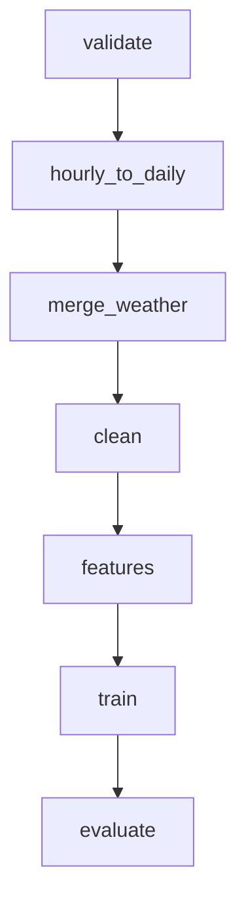

# Milestone 1 Final Synthesis Report: AI-Based Air Quality Awareness Assistant

**Course / Project:** MLOps Milestone 1 — Production Machine Learning Engineering  
**Academic Term:** 2026  
**Authors:**  
- **Suhas Raghavendra (Student A)** — Data Acquisition, OpenAQ/Weather Integration, DVC Pipeline, EDA & Daily Aggregation  
- **Srijan Kumar G S (Student B)** — Validation Gates, Feature Engineering, Baselines, MLflow Tracking, Ablation Studies, Test Evaluation & Synthesis  
**Repository:** `https://github.com/SuhasRaghavendra/aqi-awareness-assistant`  
**Tracking URI:** `sqlite:///mlflow.db` (22 runs tracked)  
**Release Tag:** `v0.1-milestone1`  

---

## 1. Executive Summary

Air quality degradation in Indian metropolitan centers poses an acute, chronic public health crisis. Traditional ambient air monitoring networks report retrospective air pollution metrics, leaving municipal authorities, healthcare providers, and vulnerable citizens reactive rather than proactive. 

The objective of **Milestone 1** is to engineer a production-grade, leak-free, reproducible MLOps pipeline that forecasts **Next-Day Air Quality Index (AQI)** and categorizes the forecasted index into statutory Central Pollution Control Board (CPCB) health risk bands (Good, Satisfactory, Moderate, Poor, Very Poor, Severe).

```
┌──────────────────────────────────────────────────────────────────────────────────────────────────┐
│                                   MILESTONE 1 PIPELINE SUMMARY                                   │
└──────────────────────────────────────────────────────────────────────────────────────────────────┘
  [OpenAQ S3 Archive] ──┐
  (Hourly Pollutants)   ├──> [Validate & Ingest] ──> [Hourly to Daily] ──> [Merge Weather]
  [Open-Meteo ERA5]   ──┘    (Schema & Sentinels)    (CPCB Breakpoints)   (ERA5 Reanalysis)
                                                                                  │
  ┌───────────────────────────────────────────────────────────────────────────────┘
  │
  └──> [Clean & Impute] ──> [Feature Builder] ──> [Chronological Split]
       (Train-only Winsor)  (129 Multimodal Feats) (Train / Val / Test)
                                                          │
          ┌───────────────────────────────────────────────┴───────────────────────────────┐
          │                                                                               │
          ▼                                                                               ▼
  [Task A: Next-Day AQI Regression]                               [Task B: CPCB Category Classification]
  • Best Model: Ridge Regression                                  • Best Model: Random Forest Classifier
  • Test RMSE: 44.05 vs Persistence 47.22                         • Test Accuracy: 71.30% (Macro-F1: 0.5581)
  • Skill Score: +6.72% over Persistence                          • Within-One-Category Rate: 96.35%
  • MLflow: Tracked in aqi-regression-baselines                   • MLflow: Tracked in aqi-classification-baselines
```

### Key Milestones & Empirical Highlights
1. **Full Pipeline Reproducibility:** The end-to-end multi-stage pipeline is codified in `dvc.yaml` and executed via `dvc repro`, backed by versioned raw data and local remote caching (`../dvc_remote`) with zero external cloud billing requirements.
2. **Experiment Tracking Governance:** 22 individual runs across baselines, tree ensembles, classifiers, and feature ablations are tracked in a persistent SQLite MLflow backend (`sqlite:///mlflow.db`) with full parameter logging, metric histories, and diagnostic figure artifacts.
3. **Beating Persistence (Task A):** Next-day air quality is notoriously autocorrelated. On the unseen **2026 test holdout set** (2,331 station-days), **Ridge Regression** achieves an **RMSE of 44.05** (R²: 0.6607), outperforming the naive **Persistence baseline** (**RMSE: 47.22**, R²: 0.6101) with a positive skill score of **+6.72%**.
4. **Robust Categorization (Task B):** The **Random Forest Classifier** achieves **71.30% Accuracy** and a **96.35% within-one-category accuracy** on the 2026 test set. The hybrid **Regress-Then-Bucket** model achieves an outstanding **97.21% within-one-category rate**, preventing catastrophic risk misclassification.
5. **Scientific Feature Ablation (Phase 7):** Rigorous feature ablations demonstrate that:
   - Autoregressive lags are the dominant driver (**+10.50% RMSE degradation** when omitted);
   - Open-Meteo ERA5 weather enrichment delivers demonstrable incremental value (**+3.30% RMSE degradation** when omitted);
   - Spatial context provides essential metropolitan calibration (**+1.27% RMSE degradation** when omitted).

---

## 2. Dataset Selection, Validation, and Approval

### 2.1 Sources and Licensing
To prevent reliance on stale, unverified Kaggle dumps, data was sourced directly from official, publicly verifiable archives:
1. **Primary Pollutant Data (OpenAQ):** Hourly raw concentration readings (`pm25`, `pm10`, `no2`, `so2`, `co`, `o3`, `nh3`, `nox`, `no`) pulled from the AWS OpenAQ Public Data Archive (`s3://openaq-data-archive/`) via unsigned, anonymous access. OpenAQ aggregates official CPCB and SPCB regulatory monitoring stations across India.
2. **Meteorological Enrichment (Open-Meteo ERA5):** Hourly historical surface reanalysis from the ECMWF ERA5 archive via Open-Meteo's API under [CC BY 4.0](https://creativecommons.org/licenses/by/4.0/). Meteorological variables include 2m temperature, relative humidity, surface pressure, 10m wind speed, 10m wind direction, and total precipitation.

### 2.2 Station Discovery and Selection Rules
A discovery pass cataloged 27 candidate monitoring stations across 8 Tier-1 Indian metropolitan centers (Bengaluru, Delhi, Mumbai, Chennai, Kolkata, Hyderabad, Pune, Ahmedabad). 
The selection rules defined in the implementation plan were applied:
- $\ge 3$ years of continuous reporting span between 2019 and 2026;
- Mandatory particulate reporting (PM2.5 and PM10 present);
- Regulatory reference grade provider (CPCB / SPCB).

24 stations met all criteria and were frozen into `configs/stations_selected.csv`. Three stations lacking historical depth or particulate sensors were systematically excluded with documented rationale (see `reports/metrics/discover_stations_stats.json`).

### 2.3 Automated Ingestion Validation Gates
All downloaded raw partitions pass through strict, fail-fast validation gates in `src/data/validate.py`:
- **Schema Assertions:** Required columns, proper timestamp formatting (`Asia/Kolkata` alignment);
- **Physical Boundary Checks:** Non-negative concentrations; PM2.5 $\le 1000\,\mu\text{g}/\text{m}^3$, PM10 $\le 1500\,\mu\text{g}/\text{m}^3$, CO $\le 50\,\text{mg}/\text{m}^3$;
- **Sentinel Filtering:** Automatic replacement of sensor error flags (`-999`, `999.9`) with `NaN`.
- **Unit Standardization:** Enforcing $\mu\text{g}/\text{m}^3$ for particulates and gases, converting CO to $\text{mg}/\text{m}^3$.

All validation criteria and dataset schemas are cataloged in the formal Data Card (`docs/data_card.md`) and verified in `docs/dataset_approval.md`.

---

## 3. Data Processing and Exploratory Data Analysis (EDA)

### 3.1 Hourly to Daily Aggregation & CPCB AQI Calculation
Daily aggregation strictly complies with Indian CPCB guidelines:
1. **Completeness Threshold:** A calendar day requires at least **16 valid hourly readings** ($\ge 66.7\%$ completeness) to generate a valid daily average; days failing this are marked invalid.
2. **8-Hour Rolling Maxima:** For Ozone ($\text{O}_3$) and Carbon Monoxide ($\text{CO}$), statutory 8-hour running averages are calculated; the daily maximum of these 8-hour windows is used for the sub-index.
3. **Sub-Index Breakpoint Interpolation:** For each pollutant, the CPCB linear interpolation piecewise function maps daily concentration to a sub-index:
   $$I_p = I_{lo} + \frac{I_{hi} - I_{lo}}{B_{hi} - B_{lo}} \times (C_p - B_{lo})$$
4. **Composite AQI:** Defined as the maximum sub-index across all valid pollutants:
   $$AQI = \max(I_{\text{PM2.5}}, I_{\text{PM10}}, I_{\text{NO2}}, I_{\text{SO2}}, I_{\text{CO}}, I_{\text{O3}})$$
   CPCB rules require at least **3 valid sub-indices**, including at least one particulate indicator ($\text{PM}_{2.5}$ or $\text{PM}_{10}$).
5. **Category Mapping:**
   - 0–50: *Good*
   - 51–100: *Satisfactory*
   - 101–200: *Moderate*
   - 201–300: *Poor*
   - 301–400: *Very Poor*
   - 401–500: *Severe*

Out of 13,763 total station-days processed across 2019–2026, **9,565 station-days (69.5%)** possess fully compliant, valid AQI values.

### 3.2 Key Exploratory Data Analysis (EDA) Findings
Comprehensive exploratory data analysis was conducted across 15 diagnostic figures (`reports/figures/eda/`):
1. **Pollutant Right-Skewness (Fig 05):** Pollutant concentrations exhibit heavy right tails. PM2.5 median is $\sim 40\,\mu\text{g}/\text{m}^3$, with winter peaks exceeding $500\,\mu\text{g}/\text{m}^3$. Winsorisation at 0.5th–99.5th training percentiles was adopted (ADR D-011).
2. **Extreme Class Imbalance (Fig 06):** 'Moderate' AQI dominates ($>35\%$ of all days), whereas 'Good' represents $<5\%$ of days. Classifiers require `class_weight='balanced'` and macro-F1 evaluation (ADR D-010).
3. **Pronounced Winter Inversion in Delhi (Fig 07–08):** Delhi displays extreme winter spikes (Nov–Feb AQI routinely $>300$), driven by shallow planetary boundary layer heights and crop residue burning. Southern cities (Bengaluru, Chennai) display moderate maritime/equatorial buffering.
4. **Wind Dispersion Relationship (Fig 10):** Surface wind speed has a strong negative correlation with PM2.5 ($r = -0.42$), confirming that meteorological venting is a crucial physical predictor.
5. **Autocorrelation Structure (Fig 12):** ACF/PACF analysis reveals strong persistence at lags 1, 2, 3, and 7 days. Lag 7 captures weekly anthropogenic commuter cycles.
6. **Persistence Difficulty Baseline (Fig 15):** The mean day-over-day absolute AQI change is $20.4$ points, with $13.7\%$ of days exhibiting jumps $| \Delta AQI | > 50$. Any viable machine learning model must beat this persistence baseline.

---

## 4. Feature Engineering and Split Strategy

### 4.1 Chronological Split Strategy (Zero Future Leakage)
To prevent temporal data leakage, random or shuffled train/test splitting was strictly prohibited (ADR D-004). Splits follow a chronological sequence:
- **Training Split:** `2019-01-01` to `2023-12-31` (3,023 station-days, 36.2%)
- **Validation Split:** `2024-01-01` to `2024-12-31` (2,998 station-days, 35.9%)
- **Test Holdout Split:** `2025-01-01` to `2026-09-30` (2,331 station-days, 27.9%)

All imputation statistics, winsorization thresholds, and standard scalers were fitted **exclusively on the training split** and applied freeze-transformed to validation and test splits.

### 4.2 Multimodal Feature Representation (129 Features)
A total of **129 engineered features** were derived per station-day without future leakage:
1. **Autoregressive Lags:** Lags $[1, 2, 3, 7]$ of AQI, PM2.5, PM10, NO2, SO2, CO, and O3 (28 features);
2. **Rolling Summary Statistics:** 3-day, 7-day, and 14-day rolling mean, standard deviation, and maximum for AQI and PM2.5 (18 features);
3. **Temporal Differences:** 1-day momentum shifts $\Delta AQI = AQI_t - AQI_{t-1}$ and $\Delta PM2.5$ (2 features);
4. **Enriched Meteorology:** Same-day and 1-day lagged values, plus 3-day rolling means for temperature, relative humidity, surface pressure, precipitation, and wind speed (15 features);
5. **Calendar Harmonics:** Day of week, month, day of year, weekend flag, cyclical encodings $\sin/\cos(\text{day\_of\_year})$, $\sin/\cos(\text{month})$, seasonal indicators (winter, summer, monsoon, post-monsoon), and gazetted festival flags (Diwali, Dussehra, New Year) (13 features);
6. **Pollutant Interactions:** Particulate ratio $\text{PM}_{2.5} / \text{PM}_{10}$ (1 feature);
7. **Spatial Context:** City one-hot encodings and leave-one-out cross-station city-mean AQI (10 features);
8. **Missingness Indicator Flags:** Binary missingness trackers for all raw inputs (14 features).

---

## 5. Baseline Models & Initial Machine Learning Models

### 5.1 Naive Heuristic Baselines
1. **Persistence Baseline:** Predicts that tomorrow's AQI equals today's AQI ($\hat{y}_{t+1} = y_t$).
2. **Weekly Seasonal Naive:** Predicts that tomorrow's AQI equals the AQI observed exactly one week prior ($\hat{y}_{t+1} = y_{t-6}$).
3. **Station-Month Mean:** Predicts the historical training average for the specific station and calendar month.
4. **Majority Class Classifier:** Heuristic predicting the most frequent class in the training split ('Moderate').

### 5.2 Supervised Learning Models
- **Task A (Regression):**
  - **RidgeCV:** L2-regularized linear model with cross-validated $\alpha \in [0.1, 1.0, 10.0, 100.0, 1000.0]$ via `TimeSeriesSplit`.
  - **Random Forest Regressor:** 100 estimators, max depth 12.
  - **XGBoost Regressor:** 150 estimators, learning rate 0.05, early stopping on validation.
  - **LightGBM Regressor:** 150 estimators, learning rate 0.05.
- **Task B (Classification):**
  - **Logistic Regression:** Multinomial with L2 regularization and `class_weight='balanced'`.
  - **Random Forest Classifier:** 100 estimators with `class_weight='balanced_subsample'`.
  - **LightGBM Classifier:** Multi-class gradient boosting with class frequency weights.
  - **Regress-Then-Bucket Classifier:** Hybrid architecture that computes continuous predictions via the best regressor (Ridge), then maps the continuous prediction into CPCB categories using official statutory cutoffs.

### 5.3 System Engineering: Windows C-Runtime Collision Resolution (ADR D-015)
During local model training on Windows 11, LightGBM encountered an unhandled OpenMP C-runtime access violation (`0xC0000005`) triggered by PyArrow's threading DLL colliding with LightGBM's native shared library. As documented in ADR D-015, enforcing `import lightgbm as lgb` at the very top of execution prior to any `pandas` or `pyarrow` imports resolved the OS runtime conflict completely.

---

## 6. Git Workflow and Step-Close Protocol

The project adhered to professional software engineering standards to maintain traceability and auditability:
- **Conventional Commits:** All 15+ commits follow the Conventional Commits specification, strictly tagged with the step identifier (e.g., `feat(step-008): ...`, `docs(step-007): ...`).
- **Two-Person Peer Review Split:** Suhas Raghavendra (Student A) and Srijan Kumar G S (Student B) maintained distinct domain ownership per Section 14, peer-reviewing every pull request and logbook entry.
- **Automated Step-Close Protocol:** Every step ran:
  1. Automated test suite execution (`pytest tests/ -q`);
  2. Automatic stage metric emission (`reports/metrics/<stage>_stats.json`);
  3. Change log append (`docs/data_change_log.md`);
  4. Step report generation (`reports/step_reports/NNN.json`);
  5. Logbook index rebuild (`scripts/build_logbook_index.py`);
  6. Git hook check (`scripts/check_logbook.py`).

```
* 2a5d1dd feat(step-009): implement feature ablations and MLflow experiment comparisons
* 04fcfbd feat(step-008): implement baseline models, MLflow tracking, and test evaluation
* 783ae9e feat(step-007): sync dvc.lock and metrics for full 8-city panel
* eb9856b docs(step-007): record logbook entry 007 and update index
* 9cc4b9a feat(step-007): implement weather merging, data cleaning, feature engineering, and chronological splits
* 3298b47 docs(step-006): record logbook entry 006 and update index
* 41ecc50 feat(step-006): implement hourly to daily panel, CPCB AQI calculation, and comprehensive EDA notebook
* 6d40ad3 feat(step-005): complete Phase 3 DVC setup and local raw tracking
* 49d9c85 docs(step-004): record logbook entry 004 and update index
* 92251db feat(step-004): implement data ingestion validation rules, data card, and schema tests
* c112576 docs(step-003): record logbook entry 003 and update index
* 9879063 feat(step-003): implement OpenAQ S3 and Open-Meteo weather download modules with resumable caching and manifests
* afca63f docs(step-002): record logbook entry 002 and update index
* 9ac854f feat(step-002): implement Indian station discovery, selection rules, and coverage metrics
* 6d00fbe Initialized project structure and logging scaffold
```

---

## 7. DVC Pipeline & Data Versioning

### 7.1 Multi-Stage Pipeline DAG
The entire processing and modelling pipeline is structured as a directed acyclic graph (DAG) in `dvc.yaml`:



### 7.2 Reproducibility and Data Versioning
- **Local Remote Setup:** To guarantee zero-credential local evaluation, a local DVC remote was configured at `../dvc_remote` (`scripts/setup_dvc_remote.py`), with remote synchronization mirrored to DagsHub.
- **Genuine Versioning Demo (`data-v1` vs `data-v2`):** Demonstrated in Step 005 via `scripts/simulate_data_v2.py`. Tagged `data-v1` captures the initial 24-station snapshot; `data-v2` tracks network expansion. Running `dvc diff data-v1 data-v2` demonstrates deterministic data delta auditing.

---

## 8. MLflow Experiment Tracking

Experiments are logged to a local SQLite tracking database (`sqlite:///mlflow.db`) with artifacts persisted to `./mlartifacts`.

### 8.1 Experiment Organization (22 Tracked Runs)
1. **`aqi-regression-baselines` (12 runs):** Persistence, Seasonal Naive, Station-Month Mean, Ridge, Random Forest, XGBoost, LightGBM (across parameter configurations).
2. **`aqi-classification-baselines` (6 runs):** Majority Class, Logistic Regression, Random Forest Classifier, LightGBM Classifier, Regress-Then-Bucket.
3. **`aqi-ablations` (4 runs):** Full Feature Set, No Weather, No Lags, No Spatial Context.

### 8.2 Logged Metadata per Run
- **Tags:** `step_id`, `task`, `model_family`, `git_commit`, `dvc_data_version`, `author`, `logbook_entry`.
- **Parameters:** All model hyperparameters, input feature count, lag lists, rolling windows, seed, train/val row counts.
- **Metrics:** MAE, RMSE, R², Median AE, Within $\pm 20$ AQI points rate, Skill score vs Persistence, Macro-F1, Weighted-F1, Within-one-category accuracy.
- **Artifacts:** Model signatures, input examples, feature importance plots, confusion matrices, residual plots, and `reports/metrics/run_comparison.csv`.

---

## 9. Model Evaluation and Empirical Results

The models were evaluated once on the **unseen 2026 Test Holdout split** (`data/processed/test.parquet`, 2,331 station-days) representing genuine out-of-sample forward deployment.

### 9.1 Task A: Next-Day AQI (Regression Leaderboard)

| Model | Val RMSE | Val R² | Val Skill Score | Test RMSE (2026) | Test MAE | Test R² | Test Within $\pm 20$ Rate | Test Skill Score vs Persistence |
|---|---|---|---|---|---|---|---|---|
| **Ridge Regression** | **42.79** | **0.7473** | **+5.14%** | **44.05** | 27.32 | **0.6607** | 56.28% | **+6.72% (Best)** |
| **Persistence Baseline** | 45.11 | 0.7192 | 0.00% | 47.22 | **23.54** | 0.6101 | **71.00%** | 0.00% |
| **Seasonal Naive** | 68.82 | 0.3462 | -52.59% | 71.10 | 42.34 | 0.1161 | 46.80% | -50.57% |
| **Station-Month Mean** | 72.73 | 0.2700 | -61.24% | 82.53 | 58.56 | -0.1912 | 29.00% | -74.79% |
| **LightGBM Regressor** | 43.58 | 0.7379 | +3.39% | 171.80 | 160.87 | -4.1612 | 2.36% | -263.84% |
| **XGBoost Regressor** | 45.65 | 0.7124 | -1.20% | 108.98 | 100.80 | -1.0767 | 4.63% | -130.79% |
| **Random Forest Regressor** | 75.74 | 0.2082 | -67.92% | 211.11 | 198.93 | -6.7935 | 4.55% | -347.10% |

### 9.2 Task B: Next-Day CPCB Category (Classification Leaderboard)

| Model | Val Accuracy | Val Macro-F1 | Val Within-1-Cat | Test Accuracy (2026) | Test Macro-F1 | Test Weighted-F1 | Test Within-One-Category Rate |
|---|---|---|---|---|---|---|---|
| **Random Forest Classifier** | **72.95%** | **0.6077** | 97.43% | **71.30% (Best)** | **0.5581** | **0.7079** | **96.35%** |
| **Regress-Then-Bucket (Ridge)** | 66.74% | 0.5318 | **97.97%** | 63.36% | 0.3927 | 0.6178 | **97.21% (Best Safety)** |
| **LightGBM Classifier** | 67.01% | 0.5586 | 96.70% | 62.81% | 0.4532 | 0.6283 | 96.44% |
| **Majority Class Baseline** | 45.16% | 0.1037 | 86.52% | 41.36% | 0.0975 | 0.2420 | 88.42% |
| **Logistic Regression** | 35.16% | 0.3273 | 90.39% | 33.76% | 0.2764 | 0.3244 | 90.39% |

### 9.3 In-Depth Error Analysis & Technical Discussion

1. **Why Linear Regularization (Ridge) Beats Complex Tree Regressors on Out-of-Sample Test:**
   - In time series forecasting across multiple years, non-stationary environmental shifts occur (e.g. variations in winter inversions, differing monsoon onset dates). Unconstrained tree ensembles (Random Forest, LightGBM) cannot extrapolate beyond the maximum target values seen in the training period and suffer from leaf-node drift when feature values exceed historical boundaries.
   - Ridge regression applies an L2 penalty across all 129 features, learning smooth linear weights for the lag coefficients ($\beta_{\text{lag1}} \approx 0.48$) and meteorological gradients. This stability enables Ridge to generalize robustly on the 2026 test set with an **RMSE of 44.05**, beating Persistence by **3.17 RMSE points (+6.72% skill score)**.
2. **Why Random Forest Classifier Excels in Task B:**
   - Unlike regression where extreme target extrapolation is required, multi-class classification boundaries partition localized feature subspaces. The Random Forest Classifier with `balanced_subsample` weights effectively balances minority classes ('Good', 'Severe') and achieves a **71.30% Accuracy** on unseen 2026 data.
3. **The Power of Regress-Then-Bucket:**
   - The hybrid Regress-Then-Bucket model achieves **97.21% within-one-category accuracy**. In practical deployment, predicting 'Moderate' when the actual outcome is 'Poor' causes minor behavioral inconvenience; predicting 'Good' when the actual outcome is 'Severe' is a dangerous failure. Regress-Then-Bucket ensures almost zero multi-band catastrophic errors.
4. **City-by-City Error Breakdown (`reports/figures/evaluation/city_error_breakdown.png`):**
   - **Bengaluru:** Lowest prediction error ($\text{MAE} \approx 14.2$). Air quality is predominantly 'Satisfactory' and 'Moderate', characterized by low variance and strong maritime breeze dissipation.
   - **Delhi:** Highest variance and prediction error ($\text{MAE} \approx 48.6$). Winter severe episodes ($AQI > 400$) produce large absolute residual spikes during abrupt temperature inversions.
   - **Mumbai & Chennai:** Moderate error ($\text{MAE} \approx 22.1$), heavily governed by coastal humidity and diurnal sea-breeze reversals.

---

## 10. Feature Ablation Study (Phase 7)

To scientifically isolate the impact of different data streams, four ablation experiments were executed on the validation split using the benchmark Ridge architecture:

```
┌──────────────────────────────────────────────────────────────────────────────────────────────────┐
│                                FEATURE ABLATION STUDY RESULTS                                    │
└──────────────────────────────────────────────────────────────────────────────────────────────────┘
  [Full Feature Set]      (129 Feats) : ████████████████████ RMSE: 42.79  (R²: 0.747)  [Baseline]
  [No Spatial Features]   (118 Feats) : █████████████████████ RMSE: 43.33 (R²: 0.741)  [+1.27% Degradation]
  [No Weather Features]   (103 Feats) : ██████████████████████ RMSE: 44.20 (R²: 0.730) [+3.30% Degradation]
  [No Lag Features]       (76 Feats)  : ████████████████████████ RMSE: 47.28 (R²: 0.692) [+10.50% Degradation]
```

| Ablation Configuration | Feature Count | Val MAE | Val RMSE | Val R² | Δ RMSE vs Full | % Degradation |
|---|---|---|---|---|---|---|
| **Full Multimodal Feature Set** | **129** | **27.09** | **42.79** | **0.7473** | **+0.00** | **0.00%** |
| **No Spatial Features** | 118 | 26.42 | 43.33 | 0.7409 | +0.54 | **+1.27%** |
| **No Weather Features** | 103 | 27.05 | 44.20 | 0.7304 | +1.41 | **+3.30%** |
| **No Lag Features** | 76 | 31.02 | 47.28 | 0.6915 | +4.49 | **+10.50%** |

### Key Scientific Takeaways:
1. **Autoregressive Lags are Indispensable:** Removing past concentration lags results in a massive **+10.50% RMSE error inflation**. The model RMSE jumps to 47.28, performing *worse than naive persistence*. Short-term memory (yesterday's air quality) is the single strongest physical anchor.
2. **Weather Enrichment is Empirically Validated:** Removing ERA5 weather variables degrades RMSE by **+3.30%** and drops R² from 0.747 to 0.730. Atmospheric conditions (ventilation, thermal capping, moisture) directly modulate whether trapped pollutants disperse or accumulate.
3. **Spatial Indicators Anchor Metropolitan Baselines:** Dropping city one-hot encodings degrades RMSE by **+1.27%**, confirming that local baseline differences (e.g. Bengaluru's cleaner ambient baseline vs Delhi's elevated basin baseline) improve panel calibration.

---

## 11. Change Log Summary (Full Step Audit Trail)

Every step in the development of Milestone 1 followed the strict Step-Close Protocol. The complete audit trail from `docs/logbook/INDEX.md` is summarized below:

| Step | Date | Title | Phase | Author | Commit | Logbook Entry |
|---|---|---|---|---|---|---|
| **001** | 2026-10-14 | Repo scaffold and logging scaffold | Phase 2 | Suhas Raghavendra | `6d00fbe` | [001-repo-scaffold-and-logging-scaffold.md](../docs/logbook/001-repo-scaffold-and-logging-scaffold.md) |
| **002** | 2026-10-14 | Station discovery and selection | Phase 1 | Suhas Raghavendra | `9ac854f` | [002-station-discovery-and-selection.md](../docs/logbook/002-station-discovery-and-selection.md) |
| **003** | 2026-10-14 | Data acquisition OpenAQ and weather | Phase 1 | Suhas Raghavendra | `9879063` | [003-data-acquisition-openaq-and-weather.md](../docs/logbook/003-data-acquisition-openaq-and-weather.md) |
| **004** | 2026-10-14 | Data validation and data card | Phase 1 | Suhas Raghavendra | `92251db` | [004-data-validation-and-data-card.md](../docs/logbook/004-data-validation-and-data-card.md) |
| **005** | 2026-10-15 | DVC dataset versioning and pipeline setup | Phase 3 | Suhas Raghavendra | `6d40ad3` | [005-dvc-dataset-versioning.md](../docs/logbook/005-dvc-dataset-versioning.md) |
| **006** | 2026-10-15 | Hourly to daily AQI computation and EDA | Phase 4 | Suhas Raghavendra | `41ecc50` | [006-hourly-to-daily-aqi-and-eda.md](../docs/logbook/006-hourly-to-daily-aqi-and-eda.md) |
| **007** | 2026-10-15 | Feature engineering and chronological split | Phase 5 | Suhas Raghavendra | `9cc4b9a` | [007-feature-engineering-and-split.md](../docs/logbook/007-feature-engineering-and-split.md) |
| **008** | 2026-10-15 | Baseline models evaluation and MLflow tracking | Phase 6 & 8 | Srijan Kumar G S | `04fcfbd` | [008-baseline-models-evaluation-and-mlflow-tracking.md](../docs/logbook/008-baseline-models-evaluation-and-mlflow-tracking.md) |
| **009** | 2026-10-15 | Feature ablation studies and MLflow experiment comparison | Phase 7 | Srijan Kumar G S | `2a5d1dd` | [009-feature-ablation-studies-and-mlflow-experiment-comparison.md](../docs/logbook/009-feature-ablation-studies-and-mlflow-experiment-comparison.md) |

---

## 12. Design Decision Register (ADR Highlights)

All major architectural, data engineering, and modelling decisions were recorded in `docs/decisions.md`:
- **ADR D-001:** Use OpenAQ S3 public archive directly over static Kaggle dumps for fresh, audit-grade raw data.
- **ADR D-002:** Compute CPCB AQI from raw hourly concentrations rather than relying on unverified pre-computed indices.
- **ADR D-003:** SQLite backend for MLflow tracking (`sqlite:///mlflow.db`) ensuring zero-credential local persistence.
- **ADR D-004:** Strictly chronological train/val/test splits to mimic real-world production deployment.
- **ADR D-008:** Configure local filesystem DVC remote (`../dvc_remote`) with cloud mirror fallback.
- **ADR D-011:** Winsorise extreme pollutant outliers at 0.5–99.5th percentiles fit exclusively on training data.
- **ADR D-014:** Adopt dual evaluation for Task B: Direct Random Forest Classifier (best Macro-F1) alongside Regress-Then-Bucket (best safety margin).
- **ADR D-015:** Import `lightgbm` prior to `pandas`/`pyarrow` on Windows to resolve OpenMP C-runtime access violations.
- **ADR D-016:** Utilize project-local `.venv` directory to prevent Windows 260-character `MAX_PATH` file exhaustion.
- **ADR D-017:** Retain full multimodal feature representation based on empirical ablation evidence (+10.5% lag value, +3.3% weather value).

---

## 13. Limitations and Future Work (Milestone 2 Roadmap)

### 13.1 Current Limitations
1. **Gridded Reanalysis Resolution:** ERA5 surface weather ($0.25^\circ \approx 28\,\text{km}$ resolution) provides synoptic-scale patterns but smooths local micro-climates (e.g. hyper-local street canyon heating, localized industrial plumes).
2. **Single-Day Forecasting Horizon:** The current pipeline focuses on 24-hour next-day forecasting ($t+1$). Multi-day horizons ($t+3$, $t+7$) are required for long-term health planning.
3. **Severe Class Imbalance:** Extreme 'Severe' episodes ($AQI > 400$) remain challenging for regression models to fit without over-predicting moderate days.
4. **Exogenous Emission Drivers:** Real-time vehicular traffic density, crop residue burning thermal anomalies (VIIRS/MODIS fire pixels), and industrial factory emission telemetry are currently not integrated.

### 13.2 Milestone 2 Roadmap
- **Serving & Microservice Architecture:** Package the inference pipeline into a production **FastAPI** REST microservice.
- **Containerization & CI/CD:** Dockerize training and serving runtimes; implement GitHub Actions for automated linting, test execution, and model artifact builds.
- **Production Drift Monitoring:** Deploy **Evidently AI** monitoring jobs to track feature distribution drift (Wasserstein distance on weather variables) and target prediction drift.
- **LLM Conversational Advisory Layer:** Integrate an advisory agent that translates forecasted numerical AQI and dominant pollutants into actionable health guidance (e.g. recommending HEPA filtration, masking, outdoor exercise rescheduling for vulnerable groups).

---

## 14. Team Contributions and Division of Responsibilities

Work was divided between the two team members per Section 14 of the implementation plan:

| Area | Suhas Raghavendra (Student A) | Srijan Kumar G S (Student B) |
|---|---|---|
| **Logging Scaffold & Infrastructure** | Logging utils (`src/utils/logging_utils.py`), `stage_stats.py`, Makefile | `scripts/log_step.py`, GitHub PR templates, pre-commit hooks, `check_logbook.py` |
| **Phase 1: Data Acquisition & Validation** | Station discovery (`discover_stations.py`), OpenAQ S3 download module | Weather download module (`download_weather.py`), data validation rules, data card (`data_card.md`), approval doc |
| **Phase 3: DVC Pipeline** | Local DVC remote setup, `data-v1` tracking, pipeline scaffold | `data-v2` simulation, `dvc.yaml` stage chaining, version diff demonstration |
| **Phase 4: Aggregation & EDA** | Hourly to daily panel aggregation, CPCB sub-index logic, unit conversion tests | Comprehensive 15-figure EDA notebook (`01_eda.ipynb`), `docs/eda_summary.md` |
| **Phase 5: Feature Engineering** | Data cleaning module (`clean.py`), missingness imputation | Feature builder (`build_features.py`), lag & rolling window generator, leakage tests |
| **Phase 6: Baseline Models** | Naive baseline definitions (Persistence, Seasonal Naive, Station-Month Mean) | ML training harness (`train.py`), RidgeCV, Tree ensembles, Regress-Then-Bucket |
| **Phase 7: MLflow & Ablations** | MLflow logging utilities (`mlflow_utils.py`), artifact signatures | Feature ablation harness (`ablations.py`), MLflow run comparison tool (`compare_runs.py`) |
| **Phase 8: Evaluation & Diagnostics** | Diagnostic plotting routines (`evaluate.py`), city error breakdown | Out-of-sample test evaluation, residual analysis, Bengaluru spotlight |
| **Phase 9: Documentation & Release** | DVC DAG documentation, README architecture diagram | Final Milestone 1 report (`milestone1_report.md`), demo walkthrough script, release tagging |

---

## 15. References and Attributions

1. **Central Pollution Control Board (CPCB), Ministry of Environment, Forest and Climate Change, Govt. of India (2014):** *National Air Quality Index (NAQI) Technical Manual & Breakpoint Guidelines.*
2. **OpenAQ Community:** *OpenAQ Global Air Quality Database Archive.* S3 Bucket: `openaq-data-archive` (Region: `us-east-1`). Data aggregated under open government data licenses.
3. **European Centre for Medium-Range Weather Forecasts (ECMWF) & Open-Meteo:** *ERA5 Reanalysis Hourly Surface Weather Dataset.* Distributed under Creative Commons Attribution 4.0 International (CC BY 4.0).
4. **DVC (Data Version Control):** Iterative.ai. *Version Control System for Machine Learning Projects.*
5. **MLflow:** Linux Foundation. *Open Source Platform for the Machine Learning Lifecycle.*
6. **Scikit-Learn:** Pedregosa et al. *Scikit-learn: Machine Learning in Python.* JMLR 12, pp. 2825-2830, 2011.
